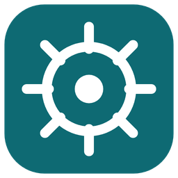
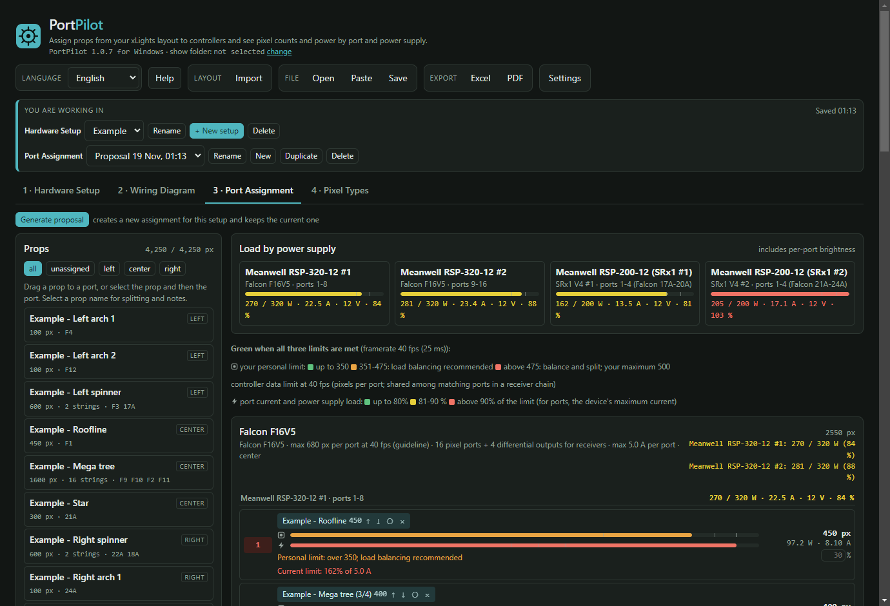
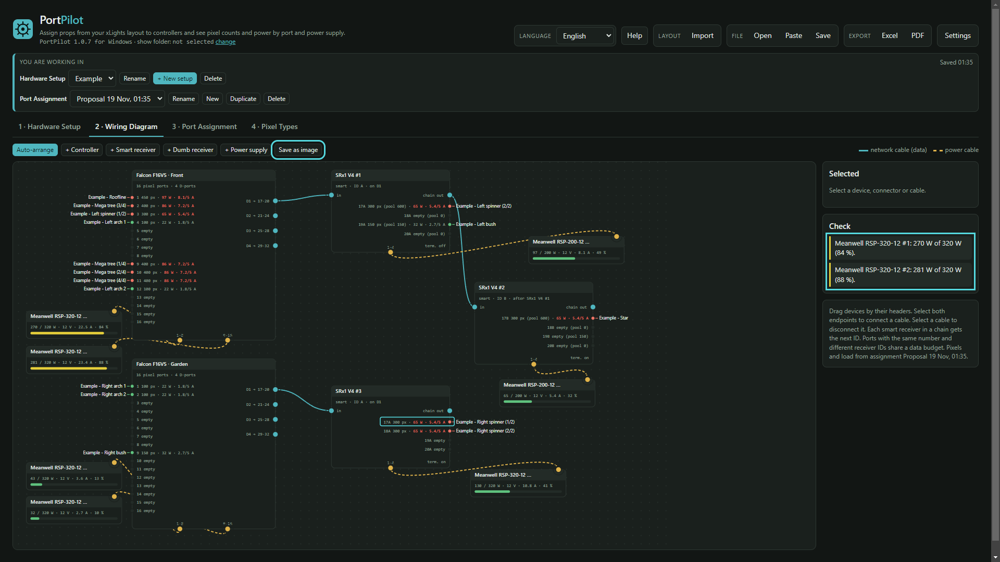

#  PortPilot

**Plan the wiring for your xLights show.** Assign props to controller and receiver ports, check pixel counts and power loads, and export a plan you can use while wiring.

**[Download for Windows][download]** · [Quick start](docs/quick-start.md) · [Examples](docs/examples.md) · [FAQ](docs/faq.md) · [Report a bug][bugs]

> **Early preview.** PortPilot is still in its early stages. More planning tools and workflow improvements are on the way. If something behaves differently from what you expect, a short bug report with steps to reproduce it is a big help.

*Drag **Left arch 1** from the Props list onto port **4** of the front controller. The cyan outlines show where to pick up and drop the prop.*

## From xLights layout to wiring plan

1. **Import your show.** Choose the xLights show folder. PortPilot reads controllers from `xlights_networks.xml` and props from `xlights_rgbeffects.xml`.
2. **Describe your hardware.** Set up your controllers, receivers and power supplies, and assign pixel types or fixed power values to your props.
3. **Assign and review.** Drag props to ports or generate a proposal. Review pixel, current and power supply warnings against your hardware.
4. **Export your plan.** Take an Excel or PDF report to the display, or save the wiring diagram as a PNG. Apply the port assignments in xLights yourself.

PortPilot reads your show files as input. Your planning work stays in PortPilot.

## Interactive wiring diagram

Follow data and power cables from controllers to smart receivers, power supplies and the props on each port. The Node-RED-style view makes it easy to trace a receiver chain and spot load warnings before heading outside.

*The cyan outline on receiver #3 points to port 17A. PortPilot shows a red dot and a red current reading of 5.4 A against the configured 5 A limit. The other outlines mark the image export and the power supply warnings.*

### Take the plan outside

Print the **PDF** or open it on a tablet to check which prop goes on which port while connecting the display. Use **Excel** for a sortable copy of the assignment, or choose **Wiring Diagram → Save as image** for a visual reference showing the data and power connections.

## Get PortPilot

Download from [the latest stable release][download].

| Download | Use it when |
| --- | --- |
| `PortPilot-Setup-x.y.z.exe` | You want a regular Windows installation and in-app updates. |
| `PortPilot-x.y.z-portable.exe` | You want to run PortPilot without installing it. Updates open the release page. |

Choose **English** or **Nederlands** and set the appearance under **Settings → Theme**. The Windows downloads are currently unsigned. The macOS edition is being prepared as a separate beta.

## Help improve PortPilot

- [Browse existing issues][issues] to see whether a problem is already reported.
- [Report a bug][bugs] with your PortPilot version, steps, expected result and actual result. A screenshot or small anonymized example helps.
- [Suggest a feature][ideas] by describing what you’re trying to do in your show and where the current workflow gets in the way.
- [See what’s planned][roadmap] for upcoming improvements.

## Project information

[Changelog](CHANGELOG.md) · [Build guide (Dutch)](LEESMIJ.md) · [GPL-3.0 license](LICENSE)

[download]: https://github.com/bozzel/PortPilot/releases/latest
[issues]: https://github.com/bozzel/PortPilot/issues
[bugs]: https://github.com/bozzel/PortPilot/issues/new?template=bug.yml
[ideas]: https://github.com/bozzel/PortPilot/issues/new?template=feature.yml
[roadmap]: https://github.com/bozzel/PortPilot/issues?q=is%3Aissue+is%3Aopen+label%3APlanned
