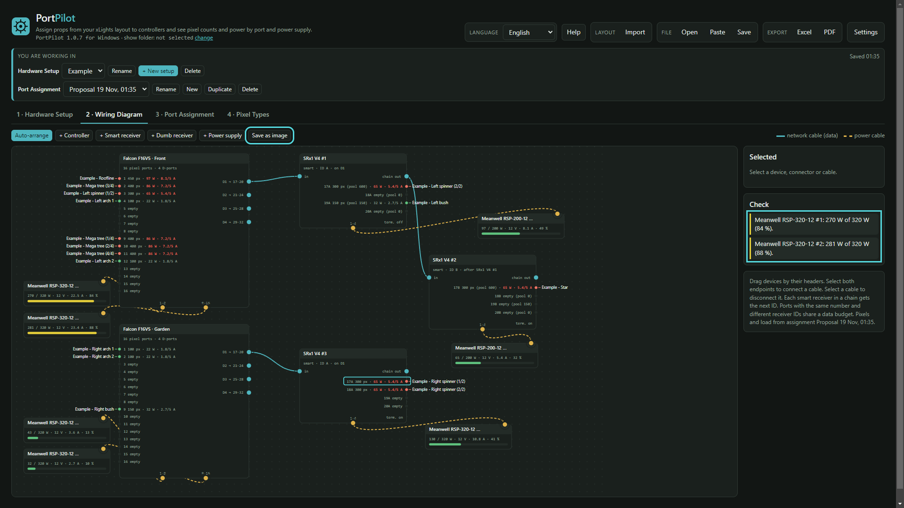

# Example workflows

[Back to PortPilot](../README.md) · [Quick start](quick-start.md) · [FAQ](faq.md)

## Compare two port assignments

Import your controllers and layout, then review the assignment created from xLights. Use **Generate proposal** to create a second assignment. Switch between them to compare the proposed port moves and review the loads before changing any wiring.

## Review a smart receiver chain

Add the controller and receivers under **Hardware Setup**. Connect the first receiver to the controller’s differential output and the second to the first receiver’s daisy-chain output. Check the receiver IDs and termination in **Wiring Diagram**. On a chain with matching ports **17A** and **17B**, review the shared controller pixel budget and each receiver’s own port and power loads.

*This sample layout uses two controllers and three smart receivers. Receiver #3 has its own differential connection to the garden controller. Its outlined port 17A shows how PortPilot marks an overloaded port in red. The estimated 5.4 A exceeds the configured 5 A limit. The Check panel shows separate power supply warnings.*

## Account for a floodlight

Open the prop under **Pixel Types**, choose **Fixed power**, and enter the wattage from the device label or datasheet. Review the power supply load after making the change. Confirm any suggested wattage before using it in your plan.
